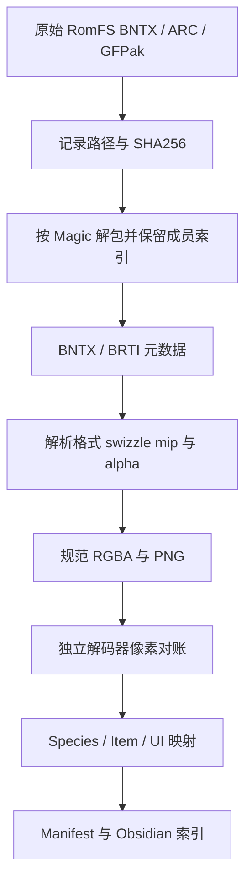

# 剑盾 v1.3.2 原版图片素材索引与管理规范

> [!summary] 本轮成果
> 已检查 master 固定提交的非截断资源子树，建立 3,445 条原始纹理/容器路径清单。UI 下有 2,635 个独立 BNTX、807 个 ARC；另有 graphics 2 个 BNTX、system_resource 1 个 BNTX。已抽查 3 个独立 BNTX 和简体中文属性 SARC 的实际字节。没有执行全量像素解码、PNG 导出或语义映射，不将文件数等同于图片数。

导航：[[00-导航]] · [[01-数据总表]] · [[02-种族与图鉴]] · [[03-进化与形态]] · [[07-道具价格与商店]] · [[11-GFPak成员提取]] · [[12-文本与多语言]] · [[14-证据分级与对账]]

## 1. 原始来源与版本

- 源提交：[固定快照](https://github.com/969981/SWSH_Resources/tree/e5b6eaaac8ab75aa9002f8c49462f6b8d4aa014e)。
- [原版 Sword RomFS UI](https://github.com/969981/SWSH_Resources/tree/e5b6eaaac8ab75aa9002f8c49462f6b8d4aa014e/v1.3.2/1/bin/appli)，[原版模型包](https://github.com/969981/SWSH_Resources/tree/e5b6eaaac8ab75aa9002f8c49462f6b8d4aa014e/v1.3.2/1/bin/archive/pokemon)，[已提取 UI 成员](https://github.com/969981/SWSH_Resources/tree/e5b6eaaac8ab75aa9002f8c49462f6b8d4aa014e/Unpack/v1.3.2/extracted/bin/appli)。
- Sword/Shield 各有 50,500 条原始清单记录；既有 README 报告 50,498 条规范路径 SHA-256 相同，仅 ExeFS main 和 main.npdm 不同。当前直接读取的是剑版 RomFS；盾版仍需按路径与源 SHA-256 验证，不称盾版实测。
- 机器可读清单：[image_source_inventory.csv](../../../Unpack/v1.3.2/catalog/image_source_inventory.csv)（3,445 行数据，不含表头）。Git blob SHA-1 是仓库对象身份，不是原始文件 SHA-256。
- 统计范围：appli、graphics、system_resource/texture 的 BNTX/ARC。未纳入全部模型 GFPak、嵌套成员、分卷、非图片布局，不能视为整游戏全部纹理。

## 2. 已核实独立纹理

所有以下路径相对于 `v1.3.2/1/bin/appli/`。

| 目录 | BNTX 数 | 原始文件示例 | 候选用途 |
|---|---:|---|---|
| icon_pokemon | 886 | poke_icon_0001_00s_n.bntx | 盒子/队伍图标 |
| icon_item | 907 | item_0001.bntx | 道具、精灵球候选 |
| icon_ribbon | 100 | ribbon_01_a.bntx | 缎带、证章候选 |
| icon_player | 82 | icon_player_logo_01.bntx | 玩家图标 |
| icon_company | 61 | icon_company_logo_00.bntx | 公司标志 |
| logo_brand | 18 | logo_brand/ 目录 | 品牌标志 |
| icon_stamp | 27 | stamp_notice_evolve_00.bntx | 通知印章 |
| pokecamp | 184 | pokecamp_curry_l_00.bntx | 咖喱及露营界面 |
| townmap | 150 | townmap_pic_000.bntx | 地图照片/界面 |
| trlicence | 220 | bin/trlicence_bg1_00.bntx | 训练家卡片素材 |
| **合计** | **2635** | | |

另有 `bin/graphics/glare_mask/mask.bntx`、`bin/graphics/renderer/FrameBufferImage.bntx`、`system_resource/texture/primitive_renderer_texture.bntx` 共 3 个系统/渲染纹理，不作为普通 UI 图标发布。

appli 子树共有 98 个一级目录、3,959 个文件：BNTX 2,635；ARC 807；BIN 348；PRMB 24；PTCL 35；DAT 108；001/002 分卷各 1。其他格式不是当然的图片。

## 3. ARC 图集与布局

| 类别 | ARC 数 | 原始文件/目录 |
|---|---:|---|
| 属性 | 9 | icon_type/bin/type_dummy_sch.arc |
| 语言 | 9 | icon_language/bin/lang_icon.arc |
| 状态 | 9 | icon_sick/ |
| 盒子 | 12 | pokebox/bin/pokebox_top.arc、pokebox_wallpaper.arc |
| 图鉴 | 13 | pokedex/bin/pokedex_top.arc、pokedex_bg.arc、pokedex_details.arc |
| 背包 | 21 | bag/ |
| 状态页 | 31 | status/ |
| 训练家卡片制作 | 41 | trlicence_maker/ |
| 盒子背景 | 包含于盒子 12 个 | pokebox/bin/pokebox_wallpaper.arc |
| 其他 | 见 CSV | battle、title、townmap 等 |

九个常见语言后缀：无后缀、eng、fre、ger、ita、kor、sch、spa、tch。无后缀语言及每个图集内部语言内容须核验，不能单凭名称断言。

盒子背景明确定位到 `pokebox_wallpaper.arc`（132,472 字节），对应 `pokebox_wallpaper_lyt.bin`（35,544 字节）和 `uikit_pokebox_wallpaper.bin`（2,048 字节）。背景数量与裁切坐标尚未确认。

已提取 UI ARC 的 21,033 个成员位于 `Unpack/v1.3.2/extracted/bin/appli/`，按 `<原名>.arc.files/000000.bin` 命名，扩展名不能用于判断成员类型。GFPak 已拆目录的递归返回被截断，不给全量成员数。

## 4. 原始字节抽样

以下为实际通过 GitHub 读取的二进制；尺寸按 BRTI +0x24/+0x28 小端字段读取，尚未做像素解码复核。

| 文件 | 字节数 | Magic | 尺寸/条目 | Git blob SHA-1 |
|---|---:|---|---|---|
| poke_icon_0001_00s_n.bntx | 16488 | BNTX/BRTI | 136×112；1 texture | 0a611936d3bea401ed907c5873268de5e0ef6839 |
| item_0001.bntx | 8296 | BNTX/BRTI | 64×64；1 texture | 9625358937bf4a3ff172b88be37c78df7749f97b |
| ribbon_01_a.bntx | 94320 | BNTX/BRTI | 128×128；1 texture | a1123c4b4d0fd0d008e62fef7c269ec28810feea |
| type_dummy_sch.arc | 241792 | SARC/SFAT | 2 members | fb31e423ed2ed04f30588f4a976c9b70b148d28f |
| pokecaplist.bin | 7072 | 无上述 Magic | 886×8 字节候选结构 | 2c7f3138acc35472bd0226cd60d468077927f812 |

简体中文属性 SARC 的已提取成员：
- `000000.bin`：488 字节，FLYT 布局；blob b3394ad0ecf376efe0b7d5f20536077cd881664a。
- `000001.bin`：233,600 字节，BNTX；NX 头纹理计数为 36，另找到 36 个 BRTI 标记；blob db29821266d41a9291c4fbf6520aad08b799be33。
- 原 SARC 可见 `typeIcon_text_00_normal_00`、`typeIcon_07_ghost_00` 等布局/纹理名称候选，需以真实 BRTI 名称及 FLYT 引用交叉验证，不能直接断言 18 属性 × 2 的语义全已恢复。

## 5. 宝可梦图标命名与索引

`poke_icon_0003_00f_n_g.bntx` 可分解为前缀、四位编号、两位形态 token、单字母 token、n token、可选 _g。对全部 886 个文件名匹配成功：

| 文件尾部 token | 数量 |
|---|---:|
| s_n | 500 |
| f_n | 97 |
| m_n | 93 |
| n_n | 158 |
| s_n_g | 25 |
| f_n_g | 6 |
| m_n_g | 5 |
| n_n_g | 2 |
| 合计 | 886 |

665 个不同首编号 token（范围 0000–0990），786 个编号+形态组合，38 个 _g 文件。注意：这不是 665 个已确认物种，编号可能含占位或特殊编号；m/f 等可能表达性别，_g 可能表达极巨相关形态，均为 CANDIDATE；n 不可直接当作普通/非闪光的实证。没有独立闪光图标的已验证证据。

重点研究 `pokecaplist.bin`：7,072 = 886×8，长度与图标数吻合，但记录字段、索引顺序、别名和映射仍待逆向。禁止按字典序强行关联。与 [species_personal.csv](../../../Unpack/v1.3.2/catalog/species_personal.csv)、种族形态表、游戏引用和实际显示进行对账。

## 6. 道具、精灵球、缎带与模型

- 道具 907 个：906 个匹配 `item_####.bntx`，编号范围 1–1606 且不连续；另有 `item_dummy.bntx`。按 [item_properties.csv](../../../Unpack/v1.3.2/catalog/item_properties.csv) 的已验证 ItemID 联结，保留缺图、多义和占位状态。精灵球作为道具子类，禁止假设独立原版 balls 目录。
- 缎带 100 个：`ribbon_01_a`、`ribbon_01_b`、`ribbon_03` 等。后缀 a/b 与 Ribbon/Mark ID 的对应均待原版查表验证。
- `bin/archive/pokemon/` 有 875 个 GFPak，`bin/archive/gpokemon/` 有 874 个 GFPak，均为非截断目录计数；样例 `pm0003_00.gfpak`、`pm0003_01.gfpak`、`pm0003_81_00.gfpak`。先检查内部模型、材质、动画、纹理类型与哈希，模型包不是高清立绘。
- 如需高清图，须明确区分原生 2D 纹理和离线 3D 渲染生成的衍生图。闪光/极巨/性别变体应通过原版材质选择或运行时验证。

## 7. 建议的统一资源库（尚未创建图片库）

```text
SWSHImageResources/
  manifest.json
  catalogs/
    image_source_inventory.csv
    texture_manifest.jsonl
    pokemon_icons.csv
    items.csv
    ribbons_marks.csv
    ui_atlas.csv
    unresolved.csv
  pokemon_icons/
  pokemon_renders/
  items/
  balls/              # 引用 items，不重复保存原像素
  ribbons/
  marks/
  types/
  languages/
  statuses/
  wallpapers/
  trainer_cards/
  maps/
  curry/
  ui/
  previews/
```

原始路径及原始文件名永不修改。导出文件用稳定 asset_id，例如 `swsh:1.3.2:icon_pokemon:poke_icon_0001_00s_n`；同一 BNTX 多纹理附加 texture_index/texture_name。业务别名以 manifest 查找，未验证字段填 null；不要用图像文件名作为唯一业务真值。不同作品 HOME / ZA / SWSH 统一业务 schema，源图、版本、风格保持独立，不覆盖。

### Manifest 字段约定

| 字段 | 说明 |
|---|---|
| asset_id, game, version, edition | 稳定资源 ID、游戏与版本、版本来源 |
| source_path, source_commit, source_sha256, git_blob_sha1 | 可复查原始证据；SHA-256 未取值填 null |
| container_type, member_index, member_hash, member_sha256 | ARC/GFPak 容器链 |
| texture_name, texture_index, width, height, format, mip_count | BNTX/BRTI 解析 |
| swizzle, color_space, alpha_mode | 解码所需参数，未知保持 null |
| output_path, output_sha256, rgba_sha256 | PNG 字节与规范像素哈希分开 |
| species_id, form_id, gender, shiny, gigantamax | 宝可梦关联字段，未知填 null |
| item_id, ribbon_id, mark_id, type_id, language | 类别适用的业务字段 |
| atlas_rect, layout_ref | 图集裁切及布局依据 |
| decoder, decoder_version, evidence_status, evidence_ref | 复现工具及证据等级 |

状态分离：SOURCE_TREE_ONLY（目录确认）、HEADER_VERIFIED（字节格式确认）、DECODED（像素输出成功）、MAPPED（游戏业务证据确认）、CANDIDATE、UNKNOWN、REJECTED。语义映射不能用 DECODED 替代。

## 8. 解码与对账流程



建议工具：现有 pkNX SWSH GFPak 提取器；SARC 解析器；Switch Toolbox 或另一个独立 BNTX 解析实现，版本固定后测试，不宣称这些工具已运行。不要直接使用 ZA/SV Trinity 解包逻辑。

本地解码输出放 ignored artifacts；保留原始尺寸、色彩空间、透明像素和 mip 层；对 BC/ASTC 等格式以 BRTI 实测为准。双实现对账记录尺寸、RGBA SHA256、RGB/Alpha 分通道误差、不同像素数、PSNR/SSIM（适用时），区分透明像素、预乘透明度和色彩转换。图集按 FLYT 引用及坐标裁切，不按肉眼盲切。

PowerShell 本地快速复核（在仓库根执行，只读）：

```powershell
Get-ChildItem .\v1.3.2\1\bin\appli -Recurse -File |
  Group-Object Extension | Select-Object Name,Count
Import-Csv .\Unpack\v1.3.2\catalog\image_source_inventory.csv |
  Group-Object category,container_type | Select-Object Name,Count
Get-FileHash .\v1.3.2\1\bin\appli\icon_pokemon\poke_icon_0001_00s_n.bntx -Algorithm SHA256
```

## 9. Obsidian 管理

本页是 31 号专题，沿用现有 Vault；CSV 存于 catalog，避免给几千个原始文件分别生成笔记。后续增加按专题的索引页（宝可梦、道具、缎带、UI 图集、模型），以本页为入口。少量获准使用的预览可用 Obsidian 本地嵌入，完整素材仅在本地保存；不把受版权保护的纹理输出或模型批量公开发布。机器索引与人类文档分开，版本更新通过 source_commit 和清单 diff 追踪。

## 10. 下一阶段研究任务

- [ ] P0：全量读取 2,638 个独立 BNTX 的实际头、BRTI 名称/格式/尺寸和 SHA256；输出 texture_manifest。
- [ ] P0：恢复 pokecaplist 886×8 候选记录结构及 icon 选择函数，完成 Species/Form/Gender/变体映射。
- [ ] P0：对账 906 编号道具与 item_properties，精灵球单独生成分类视图；dummy 不强行映射。
- [ ] P1：缎带与证章 ID 映射；属性/语言/状态九套 ARC 内部纹理与 FLYT 布局。
- [ ] P1：盒子背景、图鉴、训练家卡片、地图及咖喱资源分类。
- [ ] P2：逐个 GFPak 成员 Magic 分类，恢复模型与材质变体；有条件时输出可重复渲染图。
- [ ] P2：建立 SWSHImageResourceAudit，覆盖文件清单→容器→纹理→像素→业务 ID，并与 HOME、ZA 采用一致的字段与验证体系。

本轮完成的是静态目录及少量字节抽样、管理文档和源清单；未运行全量解码、游戏运行时、双版本逐文件复核或单元测试。原始资源保持不变。
